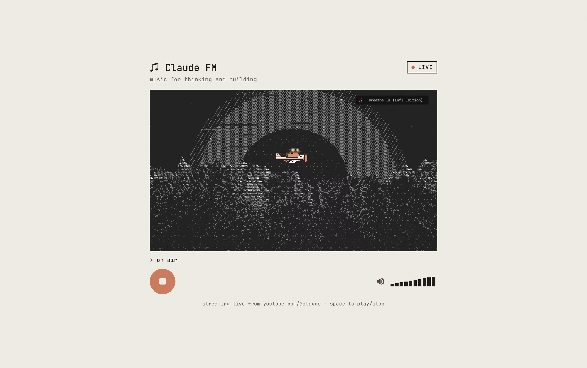

# CFM

A small Flutter radio player for the **Claude FM** 24/7 YouTube live stream
("music for thinking and building"). It plays the stream through YouTube's
official embedded player, in a retro ASCII-style design that matches the
stream.



## Features

- **Radio-style playback.** Play always jumps to the live point of the
  stream instead of resuming where you stopped.
- **Live status.** A pulsing `● LIVE` badge and a terminal-style status line
  (`> tuning in… | / - \`, `> on air`, `> stopped`). If the stream doesn't
  start within 20 seconds, it shows an error with a hint to retry.
- **Volume bars.** Tap or drag to set the volume, or use the arrow keys after
  tabbing to it. A mute button sits next to it.
- **Picture-in-picture on Android.** While music is playing, pressing Home or
  switching apps shrinks CFM into a floating video window and the music keeps
  going. Tap the window to come back, or drag it away to close it, which stops
  the music.
- **Screen stays awake while music plays.** On Android, macOS and web the
  system does this by itself while the video plays. On iOS there's a coffee
  cup button for it.
- **Space bar** plays and stops on desktop and web.
- **Layouts that fit the screen.**
  - Desktop, tablet and web: the video is sized so the controls are always
    visible without scrolling.
  - Phones in portrait: the video goes edge to edge, with the controls at the
    bottom near your thumb.
  - Rotating the phone or resizing the window doesn't stop the music.

## Platforms

| Platform | Status |
| --- | --- |
| Android | ✅ Tested on a Pixel 8 (Android 17), including picture-in-picture |
| macOS | ✅ Tested |
| Web | ✅ Tested in Chrome |
| iOS | ✅ Tested in the simulator (iPhone Air, iOS 27). No picture-in-picture: iOS can't put the embedded YouTube player into PiP. No volume bars, only mute: iOS only lets the hardware buttons change the volume of embedded video |
| Windows / Linux | ❌ Not supported: the embedded web view this player needs isn't available there |

## How it works and its limits

The app plays the stream in YouTube's official IFrame player, through
[`youtube_player_iframe`](https://pub.dev/packages/youtube_player_iframe), a
community package (not made by Google or YouTube). The package loads
YouTube's own player script in a web view and lets the app control it from
Dart. YouTube's controls are hidden and the app's controls sit on top. This
follows YouTube's Terms of Service, which forbid pulling out the audio stream
or hiding the video. That also means:

- **No audio-only background playback.** On Android, picture-in-picture
  keeps the music going while you use other apps, because the video stays
  visible. When the app is fully hidden (the PiP window is closed or the
  screen locks), the music stops. That's YouTube's rule for embedded players.
- **No track list or seeking.** It's a live stream. The current song title is
  drawn inside the video, so the app can't read it as text.

## Getting started

Requirements: Flutter 3.50+ (Dart 3.14+).

```sh
flutter pub get

flutter run -d macos     # this Mac
flutter run -d chrome    # web
flutter run              # a connected Android/iOS device (see `flutter devices`)
```

Run the tests and the analyzer:

```sh
flutter test
flutter analyze
```

## Project structure

```
lib/
├── main.dart                  # App entry point
├── app/theme.dart             # Colors and monospace typography
└── player/
    ├── station.dart           # The stream to play (YouTube video ID, name)
    ├── player_status.dart     # YouTube player state → idle / tuning / on air / stopped / error
    ├── player_screen.dart     # Main screen, wide and portrait layouts
    ├── picture_in_picture.dart # Android PiP bridge (native side in MainActivity.kt)
    └── widgets/
        ├── live_badge.dart    # Pulsing ● LIVE tag
        ├── volume_meter.dart  # Rising-bar volume control
        └── ascii_spinner.dart # | / - \ spinner
```

To point the app at a different YouTube live stream, change `videoId` in
`lib/player/station.dart`.

## Disclaimer

This is an unofficial, personal project. The Claude FM stream, the "Claude"
name and its artwork belong to Anthropic. If you publish this app to an app
store, use your own name and icon.
