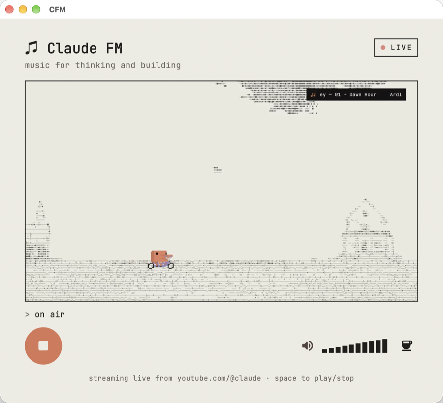
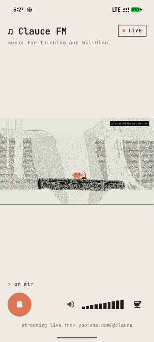

# CFM

A small Flutter radio player for the **Claude FM** 24/7 YouTube live stream
("music for thinking and building"). It plays the stream through YouTube's
official embedded player, in a retro ASCII-style design that matches the
stream.

<table>
  <tr>
    <td valign="top"></td>
    <td valign="top"></td>
  </tr>
  <tr>
    <td align="center">macOS</td>
    <td align="center">Android (Pixel 8)</td>
  </tr>
</table>

## Features

- **Radio-style playback.** Play always jumps to the live point of the
  stream instead of resuming where you stopped.
- **Live status.** A pulsing `● LIVE` badge and a terminal-style status line
  (`> tuning in… | / - \`, `> on air`, `> stopped`). If the stream doesn't
  start within 20 seconds, it shows an error with a hint to retry.
- **Volume bars.** Tap or drag to set the volume, or use the arrow keys after
  tabbing to it. A mute button sits next to it.
- **Keep screen awake** (coffee cup button). Stops the screen from sleeping
  while music is playing.
- **Space bar** plays and stops on desktop and web.
- **Layouts that fit the screen.**
  - Desktop, tablet and web: the video is sized so the controls are always
    visible without scrolling.
  - Phones in portrait: the video goes edge to edge, with the controls at the
    bottom near your thumb.
  - Rotating the phone or resizing the window doesn't stop the music.

## Platforms

| Platform | Status |
| --- | --- |
| Android | ✅ Tested on a Pixel 8 (Android 17) |
| macOS | ✅ Tested |
| Web | ✅ Tested in Chrome |
| iOS | Should work, not tested yet. The volume bars are replaced by "use the volume buttons", because iOS only allows hardware volume for embedded video |
| Windows / Linux | ❌ Not supported: the embedded web view this player needs isn't available there |

## How it works and its limits

The app uses the official YouTube IFrame player through
[`youtube_player_iframe`](https://pub.dev/packages/youtube_player_iframe),
with YouTube's own controls hidden and the app's controls on top. This
follows YouTube's Terms of Service, which forbid pulling out the audio stream
or hiding the video. That also means:

- **No background playback.** On phones the music stops when the app is in
  the background or the screen locks. This is YouTube's rule for embedded
  players. Keep the coffee-cup toggle on during long sessions.
- **No track list or seeking.** It's a live stream. The current song title is
  drawn inside the video, so the app can't read it as text.

## Getting started

Requirements: Flutter 3.50+ (Dart 3.14+).

```sh
flutter pub get

flutter run -d macos     # this Mac
flutter run -d chrome    # web
flutter run              # a connected Android/iOS device (see `flutter devices`)
```

Run the tests and the analyzer:

```sh
flutter test
flutter analyze
```

## Project structure

```
lib/
├── main.dart                  # App entry point
├── app/theme.dart             # Colors and monospace typography
└── player/
    ├── station.dart           # The stream to play (YouTube video ID, name)
    ├── player_status.dart     # YouTube player state → idle / tuning / on air / stopped / error
    ├── player_screen.dart     # Main screen, wide and portrait layouts
    └── widgets/
        ├── live_badge.dart    # Pulsing ● LIVE tag
        ├── volume_meter.dart  # Rising-bar volume control
        └── ascii_spinner.dart # | / - \ spinner
```

To point the app at a different YouTube live stream, change `videoId` in
`lib/player/station.dart`.

## Disclaimer

This is an unofficial, personal project. The Claude FM stream, the "Claude"
name and its artwork belong to Anthropic. If you publish this app to an app
store, use your own name and icon.
